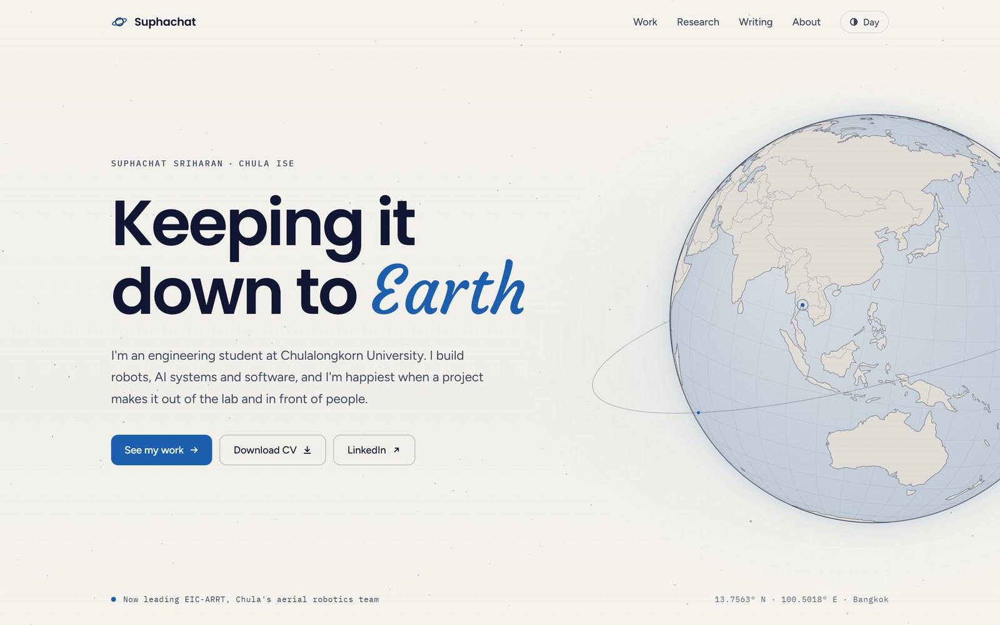

# earthbbmp.github.io

Personal website of **Suphachat Sriharan** (Earth), an engineering student at Chulalongkorn University (ISE) working on robots, AI systems and software.

**Live:** https://earthbbmp.github.io

<picture>
  <source media="(prefers-color-scheme: dark)" srcset=".github/preview-dark.jpg">
  
</picture>

## Pages

| Path | What's there |
| --- | --- |
| `/` | Globe hero, about, experience, selected work, research, honours, writing |
| `/work` | All projects by year, filterable by robotics / AI / software |
| `/research` | Papers, with code links |
| `/writing` | Posts from Medium |
| `/about` | Bio, full experience, education, skills, CV download |

## Built with

- [Astro](https://astro.build) 5, static output
- [d3-geo](https://github.com/d3/d3-geo) and [topojson-client](https://github.com/topojson/topojson-client) for the globe, with map data from [world-atlas](https://github.com/topojson/world-atlas)
- Poppins, Figtree, IBM Plex Mono and Courgette from Google Fonts, plus Prompt and IBM Plex Sans Thai for Thai text
- Night and day themes, following the system setting until you pick one
- Deployed to GitHub Pages with GitHub Actions

## Project structure

```
.
├── .github/
│   └── workflows/deploy.yml   build and deploy on every push to main
├── public/                    served as-is: CV, images, favicon
├── src/
│   ├── components/            Nav, Footer, Hero, ProjectEntry, PaperItem, ...
│   ├── data/                  the content: projects, papers, experience, honours, posts
│   ├── layouts/
│   │   └── BaseLayout.astro   <head>, nav and footer shared by every page
│   ├── pages/                 one file per route (index, work, research, writing, about, 404)
│   ├── scripts/
│   │   ├── main.js            theme toggle, nav, work filters
│   │   └── sky.js             stars and globe on the home page
│   └── styles/
│       └── global.css         all styles, theme colours at the top
├── astro.config.mjs
└── package.json
```

## Commands

Needs Node 20 or newer.

| Command | What it does |
| --- | --- |
| `npm install` | Install dependencies |
| `npm run dev` | Start the dev server at http://localhost:4321 |
| `npm run build` | Build the site into `dist/` |
| `npm run preview` | Serve the built site locally |

## Editing content

Most changes only touch `src/data/`:

| To change | Edit |
| --- | --- |
| Projects | `src/data/projects.ts`. `featured` picks the three shown on the home page. |
| Papers | `src/data/papers.ts` |
| Experience, education, skills | `src/data/experience.ts` |
| Honours | `src/data/honours.ts` |
| Posts | `src/data/posts.ts`, with the cover image in `public/assets/img/writing/` |
| CV | Replace `public/assets/docs/Suphachat_Sriharan_CV.pdf` |
| Colours | CSS variables at the top of `src/styles/global.css` |

## Deploying

Push to `main`. The workflow in `.github/workflows/deploy.yml` builds the site and publishes it to GitHub Pages, usually within two minutes. Pages are served without the `.html` extension (`/work`, `/about`).

This needs **Settings → Pages → Source** set to **GitHub Actions**.

## Credits

- d3-array, d3-geo, topojson-client and world-atlas by Mike Bostock, ISC license. d3-geo includes GeographicLib by Charles Karney, MIT license. Full texts are in [`public/third-party-licenses.txt`](public/third-party-licenses.txt).
- Map data from [Natural Earth](https://www.naturalearthdata.com/), public domain.
- Fonts from [Google Fonts](https://fonts.google.com/), SIL Open Font License.
- Writing cover photos by Janis Ringli and madeleine craine on [Unsplash](https://unsplash.com/).

## License

Text, CV and images © 2026 Suphachat Sriharan. Third-party code and fonts keep their own licenses, listed above.
